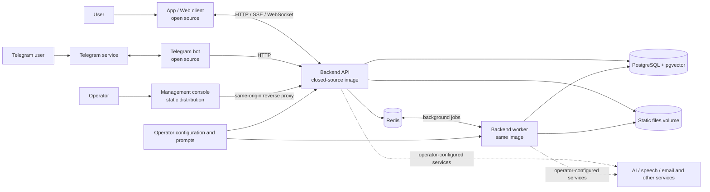

<p align="center">
  
</p>

<h1 align="center">Sorcery / Soulthread</h1>
<p align="center"><strong>AI companions · Character interactions · Immersive stories</strong></p>
<p align="center">
  <a href="README.md">简体中文</a> · English · <a href="#what-is-sorcery">About</a> · <a href="#architecture">Architecture</a> · <a href="#quick-start-empty-backend-preview">Quick start</a> · <a href="#contact">Contact</a>
</p>
<p align="center">
  <a href="apps/client/LICENSE-SCOPE.md"></a>
  <a href="licenses/backend/DISTRIBUTION-TERMS.md"></a>
  <a href="deploy/local/README.md"></a>
  <a href="https://github.com/Fishkiller111/sorcery/releases/tag/v0.2.0-preview"></a>
</p>

An AI character and interactive storytelling project with a cross-platform client, a Telegram bot, a prebuilt management console and a self-hosted backend preview.

> **Preview, not production-ready.** The client runtime dependency audit recorded 5 unresolved high-severity findings (2026-11-03). Real AI providers, Telegram, payments, voice, iOS and Android devices, and production deployment have not been fully verified. Some admin settings cannot initially be saved on an empty database, and video generation is disabled in this backend preview. Review [security and third-party status](THIRD-PARTY-STATUS.md) before deploying.

## What is Sorcery?

Sorcery / Soulthread is an AI companion and role-play application suite. Its client lets users discover or create characters, exchange messages in Free Chat, and explore story and world-based experiences. Operators can use a management console and a Telegram bot alongside a shared API. The product includes interfaces for features such as voice, images, accounts and subscriptions, but availability depends on configuration, selected services and the limitations of this preview.

### AI girlfriend and virtual companions

Sorcery supports an AI girlfriend or virtual-companion experience rather than providing a separately distributed AI model or standalone software module. The goal is to let a user interact with an AI character whose profile and conversational context shape the experience: choose or create a character, open a conversation, exchange messages and, when configured, revisit the conversation or participate in story/world experiences. The project provides the application and integration machinery; an operator must supply an AI service, model, credentials, prompts and authorized character content. Responses are generated by that configured service, and the quality of personality, memory and interactions depends on those inputs and settings. A newly initialized empty deployment contains no predefined companion and cannot chat until it has been configured.

The public distribution separates the components deliberately:

| Component | What is provided | Distribution |
|---|---|---|
| Client | Expo / React Native / Web application source | Apache-2.0 applies to the project's own source; see [scope](apps/client/LICENSE-SCOPE.md) |
| Telegram bot | Source for user entry, lightweight chat, Mini App links and optional operations integrations | Project-owned source under Apache-2.0; see [Bot documentation](apps/telegram-bot/README.md) |
| Management console | Precompiled static files and notices | No management-console source; see [distribution](distributions/admin/0.1.1-preview/README.md) |
| Backend | API and worker binaries packaged in a public container image | Closed source; [binary terms](licenses/backend/DISTRIBUTION-TERMS.md) permit free commercial use and redistribution |
| Media and content | Self-made placeholders in the client | Original project media and original backend prompt templates are not provided; operators supply authorized content |

Third-party components, services, trademarks and assets retain their own terms. Backend third-party materials and source packages concern third-party components, **not the Sorcery backend source**; see [backend notices](licenses/backend/README.md).

## Main capabilities

These describe the product's code and intended workflows, not a promise that each integration works out of the box:

- **AI characters and Free Chat:** browse or create characters, start conversations and use the HTTP / WebSocket client. Responses depend on operator-provided prompts, model configuration and a compatible backend.
- **Stories and worlds:** screens for story entry and scenes, world exploration and creation. A fresh self-hosted database has no original stories, worlds or characters; operators add their own authorized content.
- **Memory and asynchronous processing:** the backend separates the API from a worker and uses PostgreSQL/pgvector and Redis for persistence and background work. Availability and quality depend on configuration and an active worker.
- **Voice, media and creation:** the client has voice, image and video-related interfaces. Providers and credentials are external; image and voice administration has known empty-database setup issues, and **video generation is disabled** in this preview. A visible UI does not guarantee a working integration.
- **Accounts and operations:** the client contains account and entitlement interfaces; the static console provides management screens and requires an operator-created administrator. Some Telegram announcement/recall and email functions are restricted in this build. Real payment and authentication provider flows are not verified.
- **Telegram bot:** lightweight chat, character displays, Mini App entry and multilingual/optional support and operations flows. It requires a compatible backend and the operator's own Telegram configuration. Existing support and marketing copy must be reviewed and adapted before reuse.

## Architecture



The diagram shows **distribution and integration boundaries**, not a guarantee that every provider is ready or enabled. API and worker share configuration. The example Compose network permits outbound traffic; AI allowlists cover particular verified paths, not all possible egress. Operators supply services, templates and credentials.

## Repository map

```text
apps/client/                         App / Web source
apps/telegram-bot/                   Telegram bot source
distributions/admin/0.1.1-preview/   Prebuilt management console
deploy/local/                        Empty-database backend preview
licenses/backend/                    Backend distribution and third-party notices
```

- [Client setup, configuration and development](apps/client/README.md)
- [Telegram bot setup and development](apps/telegram-bot/README.md)
- [Management console setup and limitations](distributions/admin/0.1.1-preview/README.md)
- [Backend self-hosting, admin creation, prompts and AI configuration](deploy/local/README.md)
- [Placeholder media scope](apps/client/assets/PLACEHOLDERS.md)

## Quick start: empty backend preview

Requirements: Docker Engine or Docker Desktop with Compose, Python 3 and a **Linux ARM64** container runtime. The currently published image does not include an AMD64 variant. The Compose example binds the API to the host loopback address only and is intended for a controlled local test environment.

```sh
git clone https://github.com/Fishkiller111/sorcery.git
cd sorcery/deploy/local
python3 setup.py
docker compose --env-file .env up -d --wait db redis
docker compose --env-file .env run --rm init
docker compose --env-file .env up -d api worker
curl http://127.0.0.1:18888/api/v1/health
```

The image is `ghcr.io/fishkiller111/sorcery-backend:0.1.0-preview`. The published manifest digest is `sha256:ebc8897f11ede32755cdf0df6d5aaf91ca96717831392fd25a22beacab5d9e66`. For immutable pinning, set `SOULTHREAD_IMAGE` in the generated private `.env` to the image name followed by `@` and that digest.

**Run `init` only against a new empty database. Do not reinitialize an existing database or delete existing volumes to force a retry.** The fresh schema contains no administrator, characters, business data or original templates. Health alone does not verify chat or other product workflows.

Create your first administrator with the documented interactive password setup, then configure authorized content, prompts, provider credentials and AI endpoint/model allowlists. Follow the [full local guide](deploy/local/README.md), including its backup and security warnings. The sample Redis and database network setup is not a production security configuration. Keep `.env`, `private/`, `config.yaml` and provider secrets private.

## Client development

Node.js 22.13 or later is required. The existing lockfile requires `--legacy-peer-deps` for installation; the local verification environment was macOS ARM64 with Node.js 26.

```sh
cd apps/client
npm ci --legacy-peer-deps --no-audit --no-fund
cp .env.example .env.local
# Edit .env.local for your own test API and policy pages.
npm run web
```

`EXPO_PUBLIC_API_HOST` is the API root, **without** `/api/v1`. For a desktop browser using the default local Compose configuration, set it to `http://localhost:18888`. A physical phone's `localhost` is the phone itself; the default backend only listens on the development machine's loopback address, so a phone needs an appropriately secured proxy or tunnel. Production endpoints require HTTPS/WSS.

Variables prefixed `EXPO_PUBLIC_` are embedded in the client: **never put secrets there**. Without the operator's valid HTTPS privacy policy and terms, the application deliberately disables consent-dependent login and some checkout and AI-consent flows. A placeholder URL is not a valid policy.

```sh
npm run typecheck
npm run test:config
npm run test:soft-upsell
EXPO_PUBLIC_APP_SITE_URL=https://app.example.invalid \
EXPO_PUBLIC_MARKETING_SITE_URL=https://site.example.invalid \
npm run build:web
```

The `example.invalid` addresses are for isolated builds only. Web output is created in `apps/client/dist/`; a successful build is not real-service or device acceptance. See the [client guide](apps/client/README.md) for native setup, assets and platform-specific limitations.

## Telegram bot development

```sh
cd apps/telegram-bot
npm ci
cp .env.example .env
# Edit .env with your own test Bot token, URLs and backend settings.
npm run typecheck
npm run test:urlshim
npm run dev
```

Use a separate test bot: local polling removes that bot's current webhook. The bot requires its own Telegram credentials and a compatible backend; real Telegram, Mini App and payment integration have not been accepted. See the [bot guide](apps/telegram-bot/README.md) for webhook, configuration, tests and required content review. Never commit secrets.

## Management console

Use the [prebuilt admin distribution](distributions/admin/0.1.1-preview/README.md): verify its checksums, serve `static/` with SPA fallback and proxy same-origin `/api/v1/` and `/static/` to your backend. Create an administrator through the backend's documented setup first. Admin source is not included and the static bundle cannot replace backend authentication or security controls. Some operator actions are fixed off in this build; certain LLM, voice and image settings have known first-save problems on an empty database.

## Validation and known boundaries

An isolated fresh-clone test verified that schema initialization produced **218 empty tables**, rejected repeated initialization, allowed an operator-created administrator to log in, and preserved admin data after a restart. API and worker health checks passed; an isolated mock provider was used for a chat test. These results do not prove production readiness, real provider functionality, native-device functionality or a public-network deployment. The clean-clone test did not exercise the documented host-loopback `curl` path.

The client runtime dependency audit found **5 high, 10 moderate and 2 low** findings as of 2026-11-03; none should be treated as a current clean bill of health. The complete upstream license text for `standard-navigation@0.0.5` is still unresolved. Consult [third-party status](THIRD-PARTY-STATUS.md), the component notices and your own legal and security review before distribution or deployment.

## License

The project's own client and Telegram bot source is distributed under [Apache-2.0](LICENSE), subject to the stated [scope](apps/client/LICENSE-SCOPE.md). The backend remains closed source and is offered under its [binary distribution terms](licenses/backend/DISTRIBUTION-TERMS.md). Management-console terms and third-party notices are included with its [static distribution](distributions/admin/0.1.1-preview/README.md). Licenses do not automatically grant rights to trademarks, services, third-party dependencies or content.

## Contact

For project discussions or collaboration, scan the WeChat QR code below to contact the maintainer, **Fish killer**. This QR code is published in the public repository. Please do not post passwords, tokens, or private information in public issues.

<a href="docs/assets/wechat-contact.jpg"></a>

> Click the image to view it in full, then scan it with WeChat.
