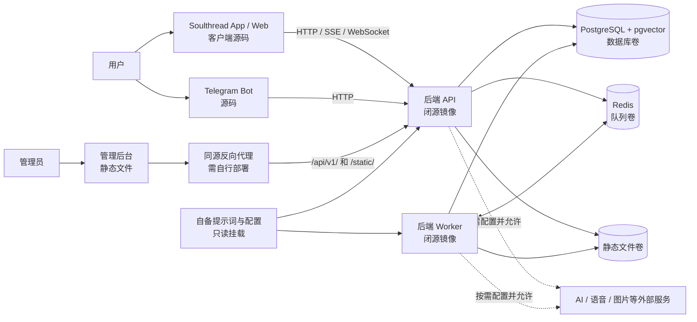

<p align="center">
  
</p>

<h1 align="center">Sorcery / Soulthread</h1>
<p align="center"><strong>与 AI 角色聊天、探索互动故事，搭建属于你的虚拟世界</strong></p>
<p align="center">
  中文 · <a href="README.en.md">English</a> · <a href="https://soulthread.talk/">官网</a> · <a href="#sorcery-是什么">项目介绍</a> · <a href="#系统架构">系统架构</a> · <a href="#快速开始空库后端">快速开始</a> · <a href="#联系方式">联系方式</a>
</p>
<p align="center">
  <a href="apps/client/LICENSE-SCOPE.md"></a>
  <a href="licenses/backend/DISTRIBUTION-TERMS.md"></a>
  <a href="deploy/local/README.md"></a>
  <a href="https://github.com/Fishkiller111/sorcery/releases/tag/v0.2.0-preview"></a>
</p>

## 10 秒了解 Sorcery

**和 AI 角色聊天、探索互动故事，也可以搭建属于自己的角色世界。**

- **自由聊天：**选择或创建虚拟伴侣，围绕角色设定和对话上下文展开交流。
- **故事与世界：**进入故事场景，与角色互动，探索自定义的世界。
- **自建与扩展：**修改 App 和 Telegram Bot 源码，配置自己的角色、提示词和 AI 服务。

**开源范围：**App 和 Telegram Bot 提供源码；管理端仅提供静态包；后端为闭源 Docker 镜像。新部署是空库，需自行配置内容和模型。

[访问官网](https://soulthread.talk/) · [查看开源范围](#发行内容和技术栈) · [本机自建](#快速开始空库后端) · [English](README.en.md)

> **预览版，不适合直接用于生产。** 本仓库提供 Soulthread 客户端和 Telegram Bot 源码、管理后台静态包，以及可自建的闭源后端镜像。客户端依赖审计有 5 项 high 尚未修复；真实第三方服务、原生设备和生产部署尚未完整验收。

## Sorcery 是什么？

Sorcery 是围绕 **AI 角色陪伴与互动叙事**构建的项目，Soulthread 是本仓库中的用户端体验。用户可以与 AI 女友或其他虚拟角色交流，或走进由场景、角色和选择组成的故事。项目希望让角色结合自身设定与对话上下文，提供持续的互动体验，而不只是一次性的问答。

系统包括：承载聊天、故事和创作界面的**用户端**；负责角色、会话、消息、记忆和模型请求等的**后端**；Telegram 内的用户及运营入口 **Bot**；以及业务管理界面。自建者可以配置自己的角色、世界、AI 服务和素材，组合出自己的体验。

本项目不是单一模型，也不随空库预览镜像赠送现成角色或故事：角色体验依赖自建者配置的模型、提示词、业务数据和相关服务。AI 生成内容具有不确定性，不能将角色响应当作事实或专业意见。

## AI 女友与虚拟伴侣：能做什么？

下表说明代码和产品设计覆盖的能力；**包含入口或实现，不代表空库、所有服务或设备上已经验收**。

| 能力 | 用途 | 自建预览状态与条件 |
| --- | --- | --- |
| AI 角色与自由聊天 | 根据角色设定和会话上下文生成对话，探索长期互动。 | 需自行创建角色、配置提示词与模型服务。隔离环境下使用模拟模型验证过聊天，真实模型未验收。 |
| 记忆与上下文 | 使用近期消息、摘要或语义检索等上下文，让角色参考以往互动。 | 后端包含相关机制；需正确配置 Worker、Redis、数据库和所需模型，真实服务与记忆效果尚需验证。 |
| 剧情模式 | 在故事场景中与角色互动，以对话、情节和选择推进叙事。 | 客户端包含剧情入口；空库无官方故事或角色，需自备有权使用的内容和配置；完整流程未验收。 |
| 角色、世界和创作 | 创建或管理角色和世界，探索不同的互动体验。 | 包含相关界面和接口；可用功能取决于账号权限、数据、配置及版本，需逐项验证。 |
| 语音与图片 | 提供语音及图片相关界面或服务对接。 | 依赖自配的服务、授权及权限；真实流程未验收，部分后台相关设置首次保存有已知问题。视频生成在本预览版关闭。 |
| Telegram Bot | 轻聊、角色展示、Mini App 入口、多语言及可选运营/客服能力。 | 需要自己的 Bot、兼容后端和服务配置；真实 Telegram、支付及公网 Webhook 尚未验收。 |
| 管理后台 | 为运营者提供业务管理界面。 | 仅发布静态包，不提供源码；部分 Telegram 公告、召回和邮件功能受限，不能仅靠运行时配置开启。 |

### AI 角色如何工作？

1. 部署者创建角色、配置模型服务与自己有权使用的提示词；用户选择角色并发送消息。
2. 后端结合角色设定、近期会话及可用的记忆上下文，调用经配置和允许的 AI 服务生成回复。
3. 用户发起的对话可通过 HTTP SSE 返回流式数据，异步消息使用 WebSocket；客户端呈现消息和互动界面。
4. Worker 消费后台任务，处理记忆摘要、向量和状态更新等工作；具体行为取决于模块、配置、服务及权限。

这是项目的逻辑机制，不代表所有功能开箱即用，也不保证长期记忆质量、角色一致性或模型效果。初始模板和模型配置缺失时不能直接聊天。

## 系统架构

下图展示自建环境的**逻辑关系**，不是一键部署后自动包含所有服务的承诺。用户端、Bot 和管理端需分别启动或托管；外部服务需部署者自行选择和配置。



AI 服务允许列表仅覆盖文档中已核验的调用路径，**不等同于全局网络防火墙**。默认 Compose 网络允许出站；外部供应商的隐私、费用、授权及网络策略由部署者负责。

## 发行内容和技术栈

| 部分 | 交付方式 | 技术及可修改范围 |
| --- | --- | --- |
| [`apps/client`](apps/client/README.md) | App / Web 自有源码，Apache-2.0 | Expo SDK 57、React Native、React、TypeScript；可修改源码并自行构建。 |
| [`apps/telegram-bot`](apps/telegram-bot/README.md) | Telegram Bot 自有源码，Apache-2.0 | Node.js / TypeScript；可修改源码并配置兼容后端。 |
| [`distributions/admin/0.1.1-preview`](distributions/admin/0.1.1-preview/README.md) | 已编译管理后台静态文件 | 允许依条款使用和再分发；不提供源码，不能按源码重新构建。 |
| 后端 API / Worker | `ghcr.io/fishkiller111/sorcery-backend:0.1.0-preview` | Go 后端闭源；同一镜像以不同命令运行 API 与 Worker，可通过支持的配置和 API 集成。 |
| [`deploy/local`](deploy/local/README.md) | 空数据库本机预览编排 | Docker Compose、PostgreSQL + pgvector、Redis；需自行准备数据和配置。 |

客户端原项目图片、SVG、音频和视频以自制占位素材替代，视觉与故事体验会降级。不要假定原项目的官方角色、故事或素材随此版本提供。示例地址和占位内容不是可直接上线的服务。

## 快速开始：空库后端

### 前提和版本

- Docker Engine / Docker Desktop、Docker Compose、Python 3；本发行镜像目前仅提供 **Linux ARM64**，尚无已发布的 AMD64 镜像。
- 镜像标签：`ghcr.io/fishkiller111/sorcery-backend:0.1.0-preview`。
- 镜像 manifest digest：`sha256:ebc8897f11ede32755cdf0df6d5aaf91ca96717831392fd25a22beacab5d9e66`。
- 示例仅面向单机隔离开发；数据库使用 `sslmode=disable`，Redis 未设密码，生产需另行加固。

克隆本仓库后，在仓库根目录运行：

```bash
cd deploy/local
python3 setup.py
# 仅对全新、完全空白的数据库初始化，不要用于已有库。
docker compose --env-file .env up -d --wait db redis
docker compose --env-file .env run --rm init
docker compose --env-file .env up -d api worker
curl http://127.0.0.1:18888/api/v1/health
```

`setup.py` 会生成随机密码、JWT 密钥和独立配置，已有文件时拒绝覆盖。初始化只创建数据库结构，不创建管理员、角色、故事、模型供应商或其他业务数据；不可为了重试而删除有价值的卷。API 默认仅监听本机 `127.0.0.1:18888`；健康检查通过不代表聊天、支付、邮件、语音或 AI 已可用。

### 创建管理员和配置内容

```bash
# 在 deploy/local 中运行；交互输入自己设置的密码，不写入命令行。
python3 admin-password.py
docker compose --env-file .env run --rm -e SOULTHREAD_ADMIN_EMAIL=you@example.com admin-init
```

把邮箱替换为自己的地址。确认管理员**创建成功后**，再单独执行 `rm -f private/admin_password` 删除一次性密码文件。已存在管理员时该初始化会拒绝重复创建。

接下来在私有 `config.yaml` 和 `.env` 中配置自己的模型服务、凭据和允许列表，并准备具有使用权的角色、素材及提示词；详见[空库自建说明](deploy/local/README.md)和[提示词说明](deploy/local/operator-prompts.md)。缺少模板或许可配置时，聊天不会回退到原产品内容。密钥不要写入仓库或公开客户端。

## 启动 App / Web

需要 Node.js **22.13 或更高版本**。以下命令从仓库根目录执行：

```bash
cd apps/client
npm ci --legacy-peer-deps --no-audit --no-fund
cp .env.example .env.local
# 编辑 .env.local：桌面本机后端默认 http://localhost:18888
npm run web
```

将 `EXPO_PUBLIC_API_HOST` 设为 API 根地址，不带 `/api/v1`；使用上面的后端默认端口时设置为 `http://localhost:18888`。真机的 localhost 是手机自身，后端默认仅监听开发机回环地址，需自行设置受控代理或隧道。构建 Web 使用 `npm run build:web`；原生入口及配置详见[客户端文档](apps/client/README.md)，iOS / Android 真机尚未验收。

`EXPO_PUBLIC_*` 会进入客户端构建产物，**不能放密钥**。登录与注册等流程需要自建者配置自己真实有效的 HTTPS 隐私政策与服务条款；不配置时相关同意入口会禁用，占位地址不等于合规。

## 启动 Telegram Bot

```bash
cd apps/telegram-bot
npm ci
cp .env.example .env
# 填写自己的 BOT_TOKEN、WEB_APP_URL、MARKETING_URL 和 API_BASE_URL
npm run dev
```

按 [Bot 文档](apps/telegram-bot/README.md) 配置自己的 Telegram Bot、可访问的地址和兼容后端。默认 polling 会删除该 Bot 当前的 webhook，请使用独立测试 Bot，勿直接使用生产 Token。真实 Telegram、支付、Mini App 和公网 webhook 尚未验收，客服知识与品牌文案需自行审查替换。

## 部署管理后台

1. 使用 [管理端静态包](distributions/admin/0.1.1-preview/README.md) 或 Release 附件，在包内执行 `shasum -a 256 -c SHA256SUMS` 校验。
2. 将 `static/` 部署到自己的静态服务器，按单页应用配置路由回退；把同源 `/api/v1/` 与 `/static/` 反向代理至兼容后端。示例及安全边界见管理端文档。
3. 使用上一步自己创建的管理员登录，再配置业务数据。静态界面不是后端权限控制的替代品。

## 二次开发与测试

- **客户端**：页面路由位于 `apps/client/app/`，业务与 UI 位于 `apps/client/src/`，请求与流式接口位于 `apps/client/src/api/`。修改源码后运行类型检查、配置测试和 Web 构建。
- **Bot**：入口和配置在 `apps/telegram-bot/src/`，可修改命令、多语言及服务集成；变更前确认兼容的后端接口。
- **后端与管理端**：不提供源码。后端支持按文档配置、自建内容及通过公开接口集成；管理端支持静态托管与代理配置，不承诺源码级修改或插件机制。

```bash
# App：在 apps/client 中
npm run typecheck
npm run test:config
npm run test:soft-upsell
npm run build:web

# Bot：在 apps/telegram-bot 中
npm run typecheck
npm run test:urlshim
npm run build
```

App 构建所用站点变量需按[客户端文档](apps/client/README.md)设置；示例地址只适合隔离构建。更多 Bot 模拟测试及前置条件见 [Bot 文档](apps/telegram-bot/README.md)。构建或健康检查通过不等于真实支付、聊天、生产安全或设备体验通过。

## 已知限制、安全与许可

- 客户端运行依赖于 2026-11-03 的本地审计为 17 项，其中 **5 high、0 critical**；结果可能变化。请重新评估并修复后再考虑生产，见[第三方依赖状态](THIRD-PARTY-STATUS.md)。
- `standard-navigation@0.0.5` 上游完整许可证文本仍待核实；需自行检查实际分发组件及第三方许可义务。
- 视频生成功能暂不可用；空库中部分后台 LLM、语音通话及 AI 生图设置首次保存存在已知问题。真实 AI、邮件、Telegram、支付、语音、iOS / Android 和生产反向代理均未完成验收。
- 空库无预设套餐时，内存中有临时免费额度和权限；具体约束、外联允许列表、备份与运维风险见[自建文档](deploy/local/README.md)。保留数据库、Redis、静态文件及私有配置的备份；不要对有价值的数据执行 `docker compose down -v`。
- 本项目有权开放的客户端和 Bot 自有源码采用 [Apache-2.0](LICENSE)；后端自有二进制的免费商用及再分发条款见[后端条款](licenses/backend/DISTRIBUTION-TERMS.md)，管理端见其发行条款。第三方依赖、素材、服务及商标不因源码许可证自动获授权。

## 联系方式

如需项目交流或讨论合作，可使用微信扫描下方二维码联系维护者 **Fish killer**。二维码在公开仓库中展示；请勿在公开 Issue 中发送密码、令牌或其他隐私信息。

<a href="docs/assets/wechat-contact.jpg"></a>

> 点击图片可查看原图；请使用微信扫码。
